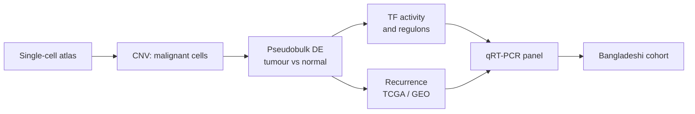
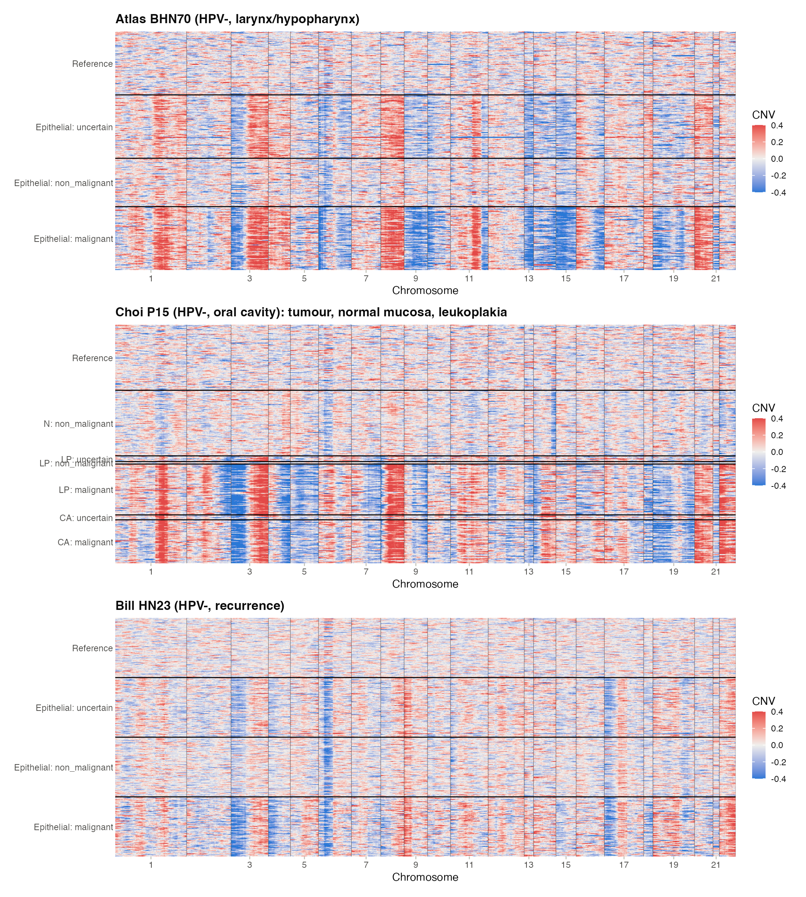
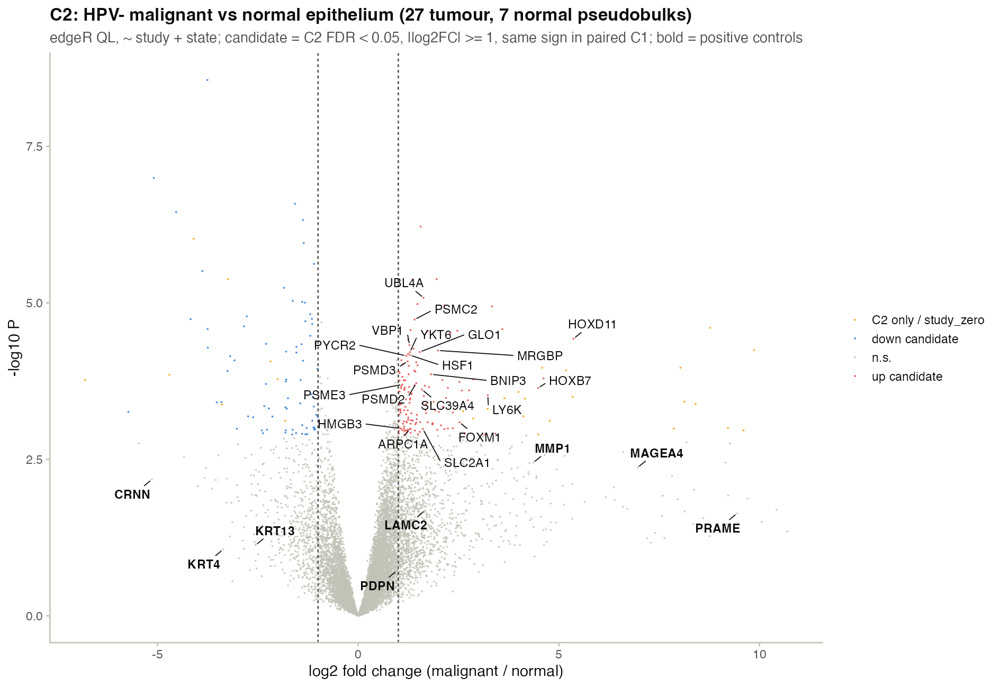
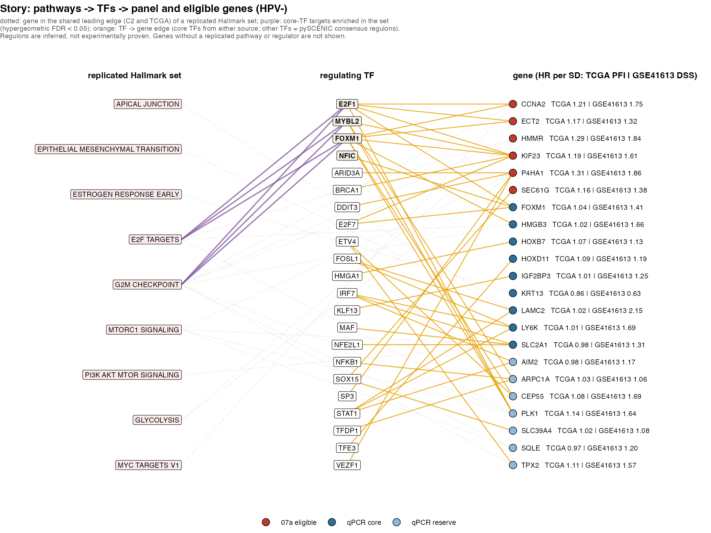
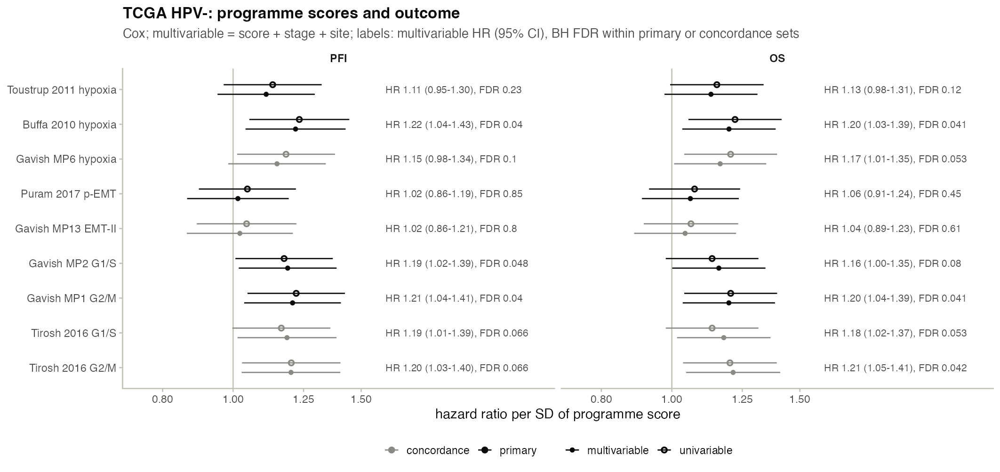

<h1 align="center">Recurrence genes and TF networks in HNSCC</h1>

<p align="center">
  <b>Single-cell RNA sequencing reveals recurrence-associated genes and their
  transcription factor networks in head and neck squamous cell carcinoma (HNSCC),
  with validation in a Bangladeshi cohort.</b>
</p>

<p align="center">
  
  
  
  
</p>

---

## Overview

| Part | What |
| --- | --- |
| 🧬 **Discovery** | HNSCatlas single-cell data (GSE234933, GSE181919, GSE164690, GSE182227). Primary analysis on HPV-negative tumour cells. |
| 🎯 **Tumour-cell genes and TFs** | Malignant cells identified by inferred CNV, compared with normal epithelium by patient-level pseudobulk (edgeR), and scored for TF activity (decoupleR, pySCENIC). |
| 📈 **Recurrence** | Programme and gene scores tested against outcome in bulk cohorts (TCGA-HNSC, GEO). |
| 🧪 **Validation** | qRT-PCR panel on tumour and matched normal tissue from Bangladeshi HNSCC patients. |



## Highlights

<table>
  <tr>
    <td width="50%" align="center">
      <b>Malignant cells by inferred copy number</b><br>
      
    </td>
    <td width="50%" align="center">
      <b>HPV-negative tumour vs normal epithelium</b><br>
      
    </td>
  </tr>
</table>

<p align="center"><b>Pathways → transcription factors → candidate genes</b></p>
<p align="center"></p>

<p align="center"><b>Tumour programme scores and outcome in TCGA HPV-negative HNSCC</b></p>
<p align="center"></p>

## Repository

```text
config/paths.R      all data and result paths
scripts/            analysis scripts, numbered in run order
results/stepNN_*/   outputs and figures, one folder per step
PLAN/               research plan and sample collection protocol
archive_v1_HPVpos/  earlier HPV-positive analysis
```

Run scripts from the repo root, e.g. `Rscript scripts/01_metadata.R`.
Requires R 4.6 (Seurat 5, edgeR, DESeq2, decoupleR, survival, ggplot2).
Data files are not in git; the atlas is available from
<https://hifis-storage.desy.de:2880/Helmholtz/E220-Radioonc_biol-DKFZ/HNSCC_Atlas.rds>.
